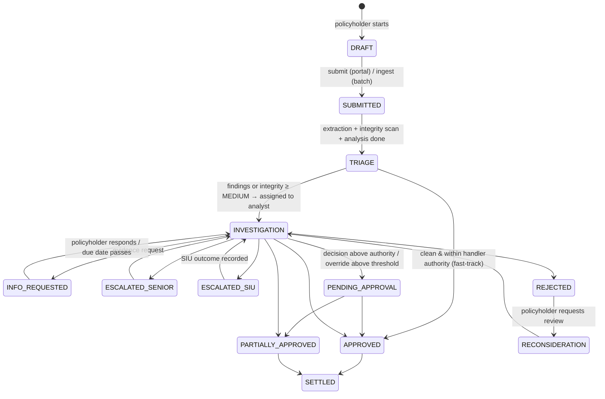

# Claims Sentinel — Level 2: Investigation Workspace, Roles & Policyholder Portal

## Context
Level 1 delivered validation, detection, leakage calculation, an alert dashboard, document extraction (ChatGroq)
and an in-progress document-integrity agent (see `HANDOFF.md`). Level 2 asks for an **investigation workspace**
that covers six capabilities:
- cross-claim correlation
- document vs claim comparison with source references
- specific settlement corrections
- per-finding analyst decisions, including escalation
- a complete audit trail with a downloadable report

The user also wants a **policyholder experience** (file a claim, upload evidence, track progress, respond to
requests, view decisions) and **proper roles and responsibilities**.

Decisions:
- **Access control:** real login with RBAC enforced by the API.
- **Handoff work:** the unfinished integrity UI and claims register are folded in as Phase 0. The claims register
  becomes the staff work queue, and the claim review page becomes the investigation workspace.

Principles carried over:
- The deterministic engine decides and the LLM explains or extracts.
- Every number is traceable.
- Suspicion is never shown as fraud, and never to policyholders.
- The UI follows `CLAUDE.md`: no generic-AI look, IBM Plex / JetBrains Mono / Source Serif, ruled dense layouts.
- Use SDK features and package-manager versions only.

---

## 1. Roles & responsibilities

| Role | Who | Responsibilities | Cannot |
|---|---|---|---|
| **Policyholder** | Insured member (or the policy holder for family members) | File claims for members on their own policy; upload bills and evidence; track status; answer evidence requests; read decisions and the settlement breakdown; request reconsideration | See other policies, findings, fraud/integrity signals, internal notes, scores |
| **Claims Handler** (intake) | Front-line processor | Triage new submissions; check completeness; confirm document extraction; send first information requests; fast-track **clean** claims within authority; route flagged claims to analysts | Decide findings; approve claims with open findings; override recommendations |
| **Claims Analyst** (investigator) | Works the investigation workspace | Decide every finding (confirm / false positive / request evidence / escalate / accept correction); add notes; propose the claim decision within authority; produce the investigation report | Approve above authority; resolve their own escalation; see SIU-restricted notes |
| **Senior Claims Reviewer** | Escalation and approval tier | Resolve analyst escalations; approve over-authority decisions; approve overrides of AI recommendations above the threshold (maker-checker); reassign cases | Edit audit history |
| **SIU Investigator** | Special Investigation Unit | Receive SIU referrals (tampering, reused documents, related-party rings); see the correlation graph and SIU notes; record the SIU outcome (substantiated / not substantiated); hold payment | Approve settlements |
| **Claims Ops Admin** | Operations manager | Manage users and roles; ingest data; run analysis; view dashboards, quality metrics and full audit | Decide claims or findings (segregation of duties) |
| **System / AI agent** | Automated actor | Detection runs, recommendations, extraction, integrity scans — every one recorded as an audit event with the model id | — |

**Authority limits** live in config and are enforced server-side:
- Handler approves ≤ ₹50,000, and only with no open findings and an integrity level of LOW.
- Analyst approves ≤ ₹2,00,000.
- Senior has no limit.
- An analyst override of a recommendation by more than ₹10,000 becomes **pending senior approval**: the maker
  can't also be the checker.
- An escalation can't be resolved by the user who raised it.

**Permission model:** named permissions (`claim:file_own`, `finding:decide`, `escalation:resolve`,
`siu:view`, `admin:users`, …) mapped to roles in one table. Each API route uses a FastAPI dependency
`require("…")`. Policyholder queries are always scoped to their own policy.

## 2. Claim lifecycle (one state machine for staff and portal)

- The **policyholder sees simplified labels:** Submitted · Under review · Action needed (INFO_REQUESTED) ·
  Decision made · Paid. ESCALATED and SIU states show as "Under review".
- Transitions are validated in one `app/workflow/lifecycle.py` (allowed transition × required permission), and each
  one writes an audit event.

## 3. Level 2 capabilities — design

### 3.1 Cross-claim correlation (`backend/app/engine/correlation.py`)
- **Entity graph** (networkx): nodes are claims, policies, members, providers, normalised invoice refs, incidents
  (member + date + diagnosis), payout accounts, contact phone/address, and document fingerprints.
- **Link rules**, each with an explanation template and a strength:

  | Strength | Link |
  |---|---|
  | Strong | Same provider + same invoice number on different policies (the spec example) |
  | Strong | Same document image (reuses `ImageFingerprint` matches) |
  | Strong | Same payout account across different policies |
  | Strong | Same incident across claims |
  | Medium | Shared phone or address across policies |
  | Medium | Same provider + same service date + same amount for different members |
  | Weak | Near-identical invoice refs (`norm_invoice_loose` in `engine/base.py`) |
- **Connected components** of strong/medium links form *correlation clusters*. Each claim gets "related claims"
  with the **matching attributes listed** (attribute, value, both claim ids).
- **New finding category `RELATED_CLAIMS` (SUSPECTED).** It is raised for strong cross-policy links and for
  clusters of 3 or more claimants sharing an account or contact (a related-party ring). It is added in
  `engine/runner.py` next to `near_duplicates`.
- **Synthetic data** (`synthetic/generate.py`):
  - add members' phone, address and payout account (masked)
  - inject a same-invoice-different-policy pair, a 3-claimant ring sharing a payout account and provider, and
    benign shared-address family members (look-alikes that must stay unflagged)
  - extend `ground_truth.csv` and `synthetic/evaluate.py`

### 3.2 Document & invoice analysis with provenance
- **Evidence model:**
  - `ClaimDocument` links a claim to its documents (invoice, discharge summary, prescription, lab report) with a
    doc type.
  - `ExtractedField` records doc_id, page, field path (e.g. `lines[3].amount`), value, `source_text` snippet,
    `verified` flag, method (text/vision) and model id.
- **Extraction** (`documents/extractor.py`) gains a `DischargeSummaryExtraction` schema (admission/discharge dates,
  diagnosis, procedures, room category, treating doctor). Each field returns a `source_text` quote.
  - For text PDFs, the quote is verified against the `pypdf` page text and stored as `verified=True/False`.
  - For vision extraction, only the page is recorded.
  - Unverified values are shown as such and are never used for leakage amounts.
- **Comparison engine** (`engine/doc_compare.py`), claim record vs each document:
  - header checks: invoice number, provider, patient/member, dates, diagnosis, length of stay vs room days billed
  - line matching: by code, then fuzzy description (rapidfuzz), date and amount
  - discrepancy types: amount differs, line in claim but not on the document, line on the document but not
    claimed, date mismatch, diagnosis mismatch, stay mismatch
  - each discrepancy links to its `ExtractedField` sources
  - new category `DOCUMENT_MISMATCH`: CONFIRMED when the claim exceeds a *verified* document value, with the
    calculated delta; SUSPECTED otherwise
- **Synthetic documents:** the generator renders an invoice and a discharge summary for about 60 pending claims
  plus the hero claim (reusing `synthetic/documents.py` `render_invoice` / `render_discharge_summary`). It plants
  discrepancies (an extra line in the claim, an inflated amount, an admission date shifted, a discharge summary
  showing 2 days while 4 room days are billed) and records them in the ground truth.

### 3.3 Investigation workspace (`/investigations/:claimId`, replaces the alert-detail-centric flow)
- **Header:** claim, member, policy, provider; lifecycle state, assignee, SLA, and the claim's total
  calculated / estimated / corrected leakage.
- **Tabs or ruled sections:**
  1. **Overview:** findings checklist with a decision control on each.
  2. **Corrections:** recommendations table, original vs corrected settlement.
  3. **Policy terms:** the rules evaluated, with full clause text.
  4. **Related claims:** a correlation list with matching attributes, plus a small graph (`@xyflow/react`).
  5. **Evidence:** a document viewer (page image with a list of extracted fields, each linking to its page and
     quote) and a side-by-side *claim vs document* comparison table with discrepancies highlighted.
  6. **Integrity:** the scan report from Phase 0.
  7. **Notes:** threaded, with visibility *internal* or *SIU only*.
  8. **Timeline / audit**.
- **Work queues** (`/queues`): the Phase 0 claims register filtered per role.

  | Role | Queue |
  |---|---|
  | Handler | Triage |
  | Analyst | My investigations |
  | Senior | Escalations & approvals |
  | SIU | Referrals |

  Assignment is automatic, round-robin among analysts, when a claim enters INVESTIGATION.

### 3.4 Recommended settlement corrections (`engine/recommendations.py`)
- Each engine `Deduction` (`engine/base.py`) or settlement-mode error (`engine/settlement.py` `Attribution`) maps to
  a typed **Recommendation**:

  | Type | From |
  |---|---|
  | `REMOVE_LINE` | duplicate line, D2/D3 |
  | `REMOVE_EXCLUDED_ITEM` | R03 |
  | `CAP_DAILY_RATE` | R04/R05 |
  | `CAP_AT_SUBLIMIT` | R06 |
  | `LIMIT_SESSIONS` | frequency cap |
  | `CORRECT_ARITHMETIC` | R10 |
  | `APPLY_DEDUCTIBLE` | R07 |
  | `APPLY_COPAY` | R08 |
  | `APPLY_SI_CAP` | R09 |
  | `ALIGN_TO_DOCUMENT` | doc mismatch |
  | `REJECT_CLAIM` | coverage / waiting / excluded diagnosis / duplicate claim |

- Each recommendation carries: target line(s), **original amount, corrected amount**, delta, the calculation
  text, rule id plus clause text, and the settlement impact from the existing attribution.
- **Corrected settlement:** the accepted recommendations are applied via `settlement.finalize`, and the
  waterfall shows proposed → corrected.
- **Immutability:** recommendations are stored as **immutable snapshots** (`Recommendation` table: version,
  generated_by, analysis run id). An optional LLM rationale is checked with the existing figures guard
  (`ai/explainer.py` `_numbers`).

### 3.5 Analyst decisions per finding (replaces CONFIRM/CORRECT/DISMISS)
`POST /api/findings/{id}/decision` with one of:

| Decision | What it requires / does |
|---|---|
| `CONFIRM_DISCREPANCY` | — |
| `FALSE_POSITIVE` | Reason required |
| `REQUEST_EVIDENCE` | Creates an `EvidenceRequest` to the policyholder or provider: message, required doc types, due date |
| `ESCALATE` | Target `SENIOR` or `SIU`, plus a reason; creates an `Escalation` and sets the lifecycle state |
| `ACCEPT_CORRECTION` | Applies the recommendation. An optional override amount needs a reason; the original stays, and a large override goes to senior approval |

- The claim-level decision (approve / partial / reject) is enabled only when **every finding has a decision**, and
  is subject to authority limits.
- Existing `FindingAction` rows are migrated into the audit log.

### 3.6 Evidence & audit trail
- **`AuditEvent` table** (append-only, no update or delete API) records:
  - event id, claim id, entity type/id, action
  - actor user id + role (or `system:agent` with the model id)
  - timestamp, `before` / `after` JSON, reason
  - `ai_generated` flag
  - **hash chain** (`prev_hash`, `hash` = sha256) so tampering with history is detectable
- **What's recorded:**
  - analysis runs (snapshot of original calculations and assessment)
  - findings and recommendations created
  - extraction and integrity results
  - decisions, overrides (original kept)
  - notes, evidence requests and responses
  - escalations, lifecycle transitions, policyholder actions
- **Investigation report** (`GET /api/investigations/{claim}/report.pdf` and `.json`), built with reportlab (already
  used), covering:
  - claim and policy
  - findings, with each decision and its history
  - recommendations: original vs final
  - discrepancies with source references
  - related claims
  - integrity scan
  - notes, plus the full audit trail with a hash-chain verification line

## 4. Policyholder portal (`/portal/*`, mobile-first, same design language)
- **Sign in:** demo accounts mapped to member records; the policy holder can file for family members on the policy.
- **Home:** policy summary (plan, sum insured, remaining balance), covered members, claims with simplified status,
  and an **Action needed** strip.
- **File a claim** (wizard, saved as DRAFT at each step):
  1. Who: the member.
  2. What happened: claim type, dates, hospital from the network list, short description.
  3. **Upload evidence:** bill, discharge summary, prescriptions, reports. Extraction pre-fills the bill lines for
     the policyholder to confirm. The integrity scan runs silently and is never shown to them.
  4. Payout account, masked.
  5. Review & declaration → SUBMITTED.
  The same pipeline as staff ingestion then runs: validation → analysis → triage.
- **Track progress:** a plain-language timeline from the lifecycle events, the current step, and the expected
  next step and date.
- **Respond to requests:** each `EvidenceRequest` shows its message, required documents and due date. The
  policyholder uploads files and replies, the state returns to INVESTIGATION, and the analyst is notified.
- **View decisions:** a decision letter with the approved amount and a plain-language breakdown generated from the
  accepted recommendations (e.g. "Room rent is capped at ₹5,000/day under your policy, Section 5.1: ₹6,000 not
  payable"), plus deductible, co-pay and payment status. Downloadable as PDF, with a **Request reconsideration**
  button that takes a reason.
- **Data exposure:** portal API serializers only. No findings, scores, integrity, correlation, internal notes or
  SIU state ever reach the portal.
- **Notifications:** an in-app `Notification` table covers requests, decisions, assignments and escalations, shown
  in the portal header and the staff rail. Email is out of scope.

## 5. Architecture additions
```mermaid
flowchart LR
  subgraph Portal[Policyholder portal /portal]
    P1[File claim wizard] --> P2[Evidence upload]
    P3[Track · Requests · Decisions]
  end
  subgraph Staff[Staff app]
    Q[Work queues] --> W[Investigation workspace]
    W --> D[Finding decisions · corrections · notes]
    W --> R[Report PDF/JSON]
  end
  API[FastAPI + JWT/RBAC require(perm)]
  Portal --> API
  Staff --> API
  API --> WF[workflow/lifecycle.py]
  API --> ENG[engine: rules · settlement · duplicates · correlation · doc_compare · recommendations]
  API --> AI[ChatGroq: extraction w/ provenance · explanations · integrity agent]
  WF & ENG & AI --> AUD[(AuditEvent hash chain)]
  ENG --> DB[(SQLite)]
```
- **Auth:** FastAPI's documented OAuth2 password flow with JWT (`pyjwt`) and password hashing (`pwdlib[argon2]`),
  added with `uv add`. Seeded users cover every role and several policyholders.
- The `X-Role` / `X-User` headers are removed. The frontend gets a login page with a demo account picker, and the
  token is kept in memory with a session-storage fallback.
- **New tables:**
  - `User`
  - `CaseAssignment`
  - `ClaimLifecycle` (state + history via audit)
  - `ClaimDocument`, `ExtractedField`, `Discrepancy`
  - `Recommendation`, `FindingDecision`
  - `EvidenceRequest`, `EvidenceResponse`
  - `Escalation`, `Note`
  - `AuditEvent`, `Notification`
  - `PayoutAccount` (masked), plus member contact fields

## 6. Build phases
| Phase | Scope | Key files |
|---|---|---|
| **0. Finish handoff** | Fix the stale page/feature cache bug (key by content hash, clear caches on reset); scan progress and report UI; claims register page | `forensics/render.py`, `forensics/duplicates.py`, `db.py`, `pages/Documents.tsx`, new `pages/Claims.tsx` |
| **1. Identity, roles, workflow, audit** | Users, JWT, `require()` permissions, authority limits; lifecycle state machine; AuditEvent hash chain; notifications; migrate existing actions; login UI + role-aware rail | new `app/auth/`, `app/workflow/`, `app/audit.py`; `api/*` dependency swap; `App.tsx`, new `pages/Login.tsx` |
| **2. Engine & data** | Correlation engine + RELATED_CLAIMS; discharge-summary extraction with provenance; doc_compare + DOCUMENT_MISMATCH; recommendations; synthetic extensions + ground truth + evaluation | `engine/correlation.py`, `engine/doc_compare.py`, `engine/recommendations.py`, `documents/extractor.py`, `synthetic/*` |
| **3. Staff investigation UI** | Queues; investigation workspace (all sections); finding decisions, escalations, evidence requests, notes, corrections, report export | new `pages/Queues.tsx`, `pages/Investigation.tsx`, shared components extracted from `AlertDetail.tsx` |
| **4. Policyholder portal** | Portal routes and serializers; claim wizard; tracking; requests; decision letter PDF; reconsideration | new `api/portal.py`, `frontend/src/portal/*` |
| **5. Verify & document** | Tests, evaluation, live Groq run, browser walkthroughs per role, README + roles doc | `backend/tests/*`, `README.md` |

After Phase 2, Phases 3 and 4 share only the API contract, so they can run in parallel in separate sessions.

## 7. Verification
- **pytest:**
  - RBAC matrix: every role × key endpoint gives the expected 200 or 403, and a policyholder can't read another
    policy's claim.
  - Lifecycle: illegal transitions are rejected; authority limits apply; the maker-checker rule on overrides;
    nobody can resolve their own escalation.
  - Audit: every write creates an event; the hash chain verifies; editing a row breaks verification.
  - Correlation: the planted same-invoice/different-policy pair and the account ring are found, and
    shared-address family look-alikes aren't.
  - Doc comparison: planted discrepancies are detected with the correct source field references, and unverified
    values never drive amounts.
  - Recommendations: original/corrected/delta are right for each type, and the corrected settlement equals the
    engine's expected settlement.
  - The existing ground-truth evaluation stays at 100%, extended with the new scenarios.
- **Live Groq run:** discharge-summary extraction with verified quotes; recommendation rationales pass the figures
  guard.
- **Browser walkthroughs** in the preview pane, one per role:
  1. Policyholder files the hero-like claim and uploads a bill.
  2. Handler triages it.
  3. Analyst works the case: decides every finding, requests evidence, accepts corrections, overrides one with a
     reason, and escalates to SIU.
  4. Policyholder sees "Action needed" and responds.
  5. SIU records an outcome.
  6. Senior approves the override.
  7. Analyst issues a partial approval.
  8. Policyholder sees the decision letter breakdown.
  9. Download the investigation PDF and JSON and check they contain the original recommendation, the override
     reason and the full audit trail.
