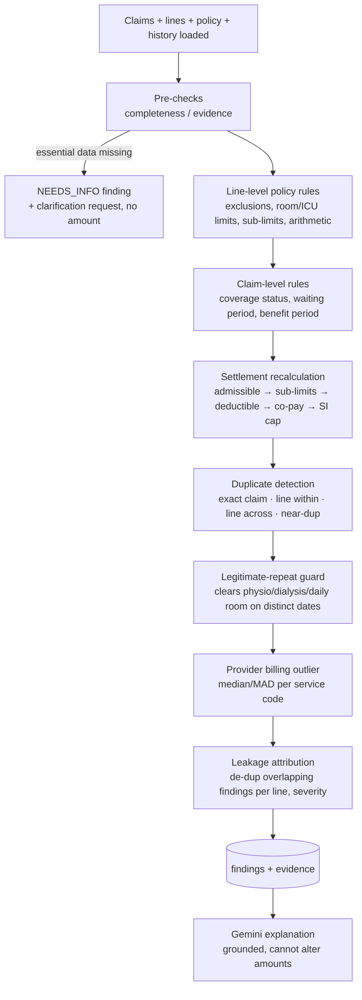
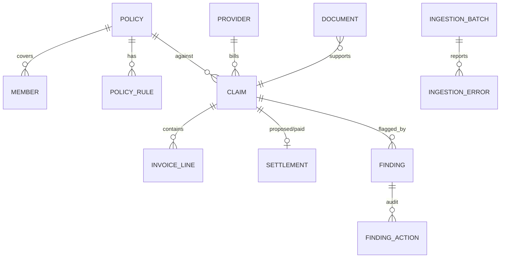

# Claims Leakage Detection Agent — Level 1 Implementation Plan

## Context
Hackathon problem (Azentio): build an AI-powered app that ingests health insurance claims, policies, invoice lines and claim history, detects financial leakage (duplicates, limit breaches, exclusions, settlement miscalculations), quantifies it, explains it, and lets reviewers confirm / correct / dismiss each finding. Level 1 (≈3 h) = ingestion + policy rule validation + duplicate detection + leakage calculation + explainable alert dashboard. Judges evaluate **live application behaviour**, so the app must run end-to-end on realistic synthetic data with known planted anomalies.

Decisions: **FastAPI (Python) + React (Vite/TS)**, **Groq via LangChain ChatGroq** for AI parts (switched from Google Gemini), **Health insurance only**. Working dir `D:\azentio claims agent` is empty (greenfield).

Core design principle: **deterministic engine decides, LLM explains.** Every finding and amount comes from code with a traceable rule/calculation; The LLM only extracts data from documents and writes narrative explanations grounded in the finding's evidence JSON. This keeps findings auditable and avoids "invented" findings (scenario 5).

---

## 1. Architecture

### 1.1 System architecture
```mermaid
flowchart LR
  subgraph FE[React + Vite + TS  (frontend/)]
    UI1[Ingestion page<br/>upload CSV/XLSX/JSON/PDF<br/>row-error viewer]
    UI2[Dashboard<br/>KPIs + charts + filters]
    UI3[Alert detail<br/>evidence, calc, waterfall,<br/>confirm/correct/dismiss]
  end
  subgraph BE[FastAPI  (backend/app)]
    API[REST API /api/*]
    ING[Ingestion & Validation<br/>pandas + Pydantic]
    DOC[Document Extractor<br/>Gemini structured output]
    ENG[Detection Engine<br/>rules · settlement · duplicates · outliers]
    EXP[Explainer<br/>Gemini narrative + template fallback]
    REV[Review workflow + audit log]
  end
  DB[(SQLite via SQLModel)]
  GEM[[Google Gemini API<br/>google-genai SDK]]
  SYN[Synthetic data generator<br/>Faker en_IN + injection + ground truth]

  UI1 --> API --> ING --> DB
  UI1 --> API --> DOC --> GEM
  DOC --> DB
  API --> ENG --> DB
  ENG --> EXP --> GEM
  UI2 & UI3 --> API --> REV --> DB
  SYN -->|sample_data/*.csv|xlsx|json|pdf| UI1
  SYN -->|"Load demo data" button| API
```

### 1.2 Detection pipeline (per analysis run)


### 1.3 Data model (SQLModel tables)

Key fields:
- **policy**: policy_no, holder, plan, sum_insured, start/end date, status, deductible, copay_pct, room_rent_limit_per_day, icu_limit_per_day, initial_waiting_days.
- **policy_rule**: policy_no/plan, rule_id, clause_ref ("Sec 4.2"), type (`EXCLUSION_CODE`, `EXCLUSION_CATEGORY`, `EXCLUSION_DIAGNOSIS`, `SUBLIMIT_PER_CLAIM`, `SUBLIMIT_PER_YEAR`, `FREQUENCY_CAP`, `DISEASE_WAITING`), target (code/category/ICD prefix), value, text.
- **claim**: claim_id, policy_no, member_id, claimant_name, incident/admission/discharge dates, claim_type (inpatient/daycare/outpatient/pharmacy/physio), diagnosis_icd10, provider_id, invoice_no, requested_amount, submitted_date.
- **invoice_line**: line_id, claim_id, invoice_no, provider_id, service_date, service_code, description, category (room, icu, diagnostics, pharmacy, consumables, procedure, consultation, physio, ambulance), qty, unit_price, amount.
- **settlement**: claim_id, proposed_amount, approved_amount, paid_amount, paid_date, status (history rows = previously paid claims; also `paid_line` linkage for cross-claim line duplicates).
- **finding**: id, claim_id, line_ids[], category, rule_id/pattern_id, clause_ref, **finding_type** (`CONFIRMED_VIOLATION` | `SUSPECTED_PATTERN` | `NEEDS_INFO`), **amount_basis** (`CALCULATED` | `ESTIMATED` | `NOT_DETERMINABLE`), leakage_amount, calculation_text (e.g. "(₹7,000 − ₹5,000) × 3 days = ₹6,000"), evidence JSON (record refs, matched claim, scores), severity, confidence, status (`OPEN`/`CONFIRMED`/`CORRECTED`/`DISMISSED`), corrected_amount, ai_explanation.
- **finding_action**: finding_id, user, role, action, reason, old/new amount, timestamp (audit trail).

### 1.4 Repository layout
```
backend/
  pyproject.toml
  app/
    main.py                 # FastAPI app, CORS, routers
    config.py               # pydantic-settings (GEMINI_API_KEY, DB url, thresholds)
    db.py, models.py        # SQLModel tables
    schemas/                # Pydantic row schemas for ingestion + API DTOs
    ingestion/              # readers (csv/xlsx/json), validators, referential checks
    documents/extractor.py  # Gemini PDF/image → InvoiceExtraction schema
    engine/
      base.py               # Finding dataclass, Detector protocol, registry
      completeness.py       # NEEDS_INFO checks
      policy_rules.py       # coverage, waiting, exclusions, room/ICU, sub-limits, arithmetic
      settlement.py         # expected settlement recalculation + waterfall
      duplicates.py         # exact / line / cross-claim / near-dup + legit-repeat guard
      provider_outliers.py  # robust z-score per service code
      attribution.py        # overlap de-dup, severity, totals
      runner.py             # orchestrates detectors, persists findings
    ai/explainer.py         # Gemini narrative + template fallback
    api/                    # routers: ingest, documents, analysis, findings, claims, dashboard, demo, evaluation
    synthetic/              # generator (see §3)
  tests/                    # pytest per detector + ground-truth eval
frontend/                   # Vite React TS, Tailwind + shadcn/ui, TanStack Query/Table, Recharts, React Router
sample_data/                # generated outputs (committed for judges)
README.md
```

---

## 2. Build plan (Level 1 capabilities)

### Step 0 — Scaffold (use scaffolding tools, let package managers resolve versions)
- `uv init backend` then `uv add fastapi "uvicorn[standard]" sqlmodel pandas openpyxl python-multipart rapidfuzz google-genai pydantic-settings faker reportlab` and `uv add --dev pytest httpx` (fallback: `python -m venv` + pip if uv absent).
- `npm create vite@latest frontend -- --template react-ts`, then `npx shadcn@latest init` (Tailwind setup per shadcn's current Vite guide), `npm i @tanstack/react-query @tanstack/react-table recharts react-router-dom`.
- No hand-pinned versions; check current Gemini model ID in Google's model docs at implementation time (default to the current Flash model, configurable via env).

### Step 1 — Ingestion & validation (capability 6)
- `POST /api/ingest/{dataset}` for `policies | policy_rules | members | providers | claims | invoice_lines | settlements`; accepts **CSV, XLSX (any sheet name matching dataset), JSON**; also a **bundle** upload (multi-sheet XLSX or ZIP) for one-shot loads.
- Read with `pandas.read_csv/read_excel/read_json`; validate each row through a **Pydantic model** (types, mandatory fields, `amount ≥ 0`, ISO/DD-MM date parsing, ID regex like `CLM-\d{6}`, `discharge ≥ admission`, `qty × unit_price ≈ amount` warning).
- Referential checks after row validation: claim→policy, line→claim, claim→provider, duplicate primary keys within the file and vs DB.
- **Never silently ignore**: every rejected row stored in `ingestion_error` (batch, row #, field, value, message, severity error/warning); batch summary = received / accepted / rejected / warnings; UI shows an error table with download as CSV. Warnings (e.g. arithmetic mismatch) are accepted but carried into the engine.
- **Documents**: `POST /api/documents` (PDF/JPG/PNG invoice or discharge summary) → `documents/extractor.py` calls Gemini via `google-genai` `generate_content` with the file part + `response_schema=InvoiceExtraction` (Pydantic) → preview in UI with per-field confidence → `POST /api/documents/{id}/confirm` turns it into claim/invoice lines (passing the same row validation). Missing key fields stay null → feed NEEDS_INFO.
- `POST /api/demo/load-sample` loads the generated dataset in one click.

### Step 2 — Policy rule validation (capability 7) — `engine/policy_rules.py`, `engine/settlement.py`
Each check emits a result with `rule_id`, `clause_ref`, outcome (PASS/FAIL/NA) — passes are stored as a compact "rules evaluated" list so the alert detail shows *all* rules applied, not only failures.

| Rule | Check | Leakage calc (CALCULATED) |
|---|---|---|
| R01 Coverage status | policy active & incident within start–end; member on policy | full claim amount |
| R02 Waiting period | initial 30-day + disease-specific (ICD prefix) waiting | full claim amount |
| R03 Exclusions | line code/category in exclusion list (non-payable consumables: gloves, masks, admission kit…); diagnosis exclusions (cosmetic, etc.) | excluded line amounts |
| R04 Room rent limit | room unit_price > per-day limit | (price − limit) × days |
| R05 ICU limit | same for ICU | (price − limit) × days |
| R06 Sub-limits | per-claim (cataract, ambulance), per-year using history (physio cap), frequency caps | amount over sub-limit (net of prior use) |
| R07 Deductible | applied in recalculation | see settlement |
| R08 Co-payment | applied in recalculation | see settlement |
| R09 Sum insured / benefit cap | remaining SI = SI − paid in policy year (from history) | amount over remaining SI |
| R10 Arithmetic | qty × unit_price ≠ amount; invoice total ≠ Σ lines | difference |

**Settlement recalculation (capability 3 scenario)** — `settlement.py` produces an ordered waterfall:
`billed → − duplicates − excluded − over-limit (room/ICU/sub-limits) = admissible → − deductible → − co-pay % → cap at remaining SI = expected settlement`.
Compare with `proposed_amount`; if `proposed − expected > tolerance (₹1)` → finding `SETTLEMENT_MISCALC` (CALCULATED) with the step where it diverges (e.g. "co-pay of 20% not applied: ₹8,400"). Waterfall JSON is returned to the UI as a chart.

### Step 3 — Duplicate detection (capability 8) — `engine/duplicates.py`
- **Exact duplicate claim**: normalized key on (member, provider, normalized invoice_no) or (member, provider, admission date, requested amount) across claims & history → CONFIRMED, CALCULATED = amount of later submission (or already-paid amount).
- **Duplicate line within claim**: same (service_code, service_date, unit_price, provider) appearing > allowed in the same invoice for non-repeatable codes → CONFIRMED, extra occurrences' amount.
- **Duplicate line across claims**: line matches a paid line on another claim of the same member (code, date, amount, provider) → CONFIRMED, CALCULATED.
- **Near-duplicate**: block by member (and policy), compare pairs with a weighted score: invoice_no similarity (`rapidfuzz.fuzz.ratio` on normalized refs, catches `INV-0123` vs `INV-00123` / transpositions), |date diff| ≤ 3 days, |amount diff| ≤ 5%, same provider, same diagnosis, line-set Jaccard overlap. Score ≥ threshold → SUSPECTED_PATTERN, ESTIMATED = min(amounts) × overlap; evidence includes per-attribute score breakdown and the side-by-side pair.
- **Legitimate repeat guard**: service catalog flags repeatable codes (physio, dialysis, chemo, daily room, follow-up consultation). Repeats on **distinct service dates**, within frequency caps, and consistent with the stay length are *not* flagged; the engine records a "considered & cleared" note (shown in the claim view) to prove the case was evaluated. Exceeding a frequency cap is a R06 sub-limit finding, not a duplicate.

### Step 4 — Extra detection (beyond spec, cheap in L1)
- **Completeness / incomplete evidence** (`completeness.py`): missing diagnosis code, discharge date for inpatient, invoice ref, or line details → `NEEDS_INFO`, `NOT_DETERMINABLE`, with a generated clarification request (Gemini-drafted, template fallback). Rules that depend on missing data are marked NA, not failed.
- **Provider billing outlier** (`provider_outliers.py`): per service_code, robust z = (price − median)/(1.4826·MAD) over peer providers in same city tier; z > 3.5 → SUSPECTED, ESTIMATED = (price − peer P75) × qty. Wording: "for review, not a fraud determination".

### Step 5 — Leakage assessment & severity (capability 9) — `attribution.py`
- Every finding carries `amount_basis` + human-readable `calculation_text`.
- **No double counting**: when multiple findings hit the same line (e.g. a duplicated excluded consumable), dashboard totals attribute the line once using priority (duplicate > exclusion > limit > outlier); the secondary finding shows "overlaps finding #X".
- Totals reported separately: **Calculated leakage** vs **Estimated (suspected) leakage** vs **Needs info count**.
- Severity: High (CALCULATED ≥ ₹25k, any exact duplicate claim, coverage failure), Medium (≥ ₹5k or suspected with high score), Low otherwise — thresholds in config.

### Step 6 — Gemini explainer — `ai/explainer.py`
- Input: finding + evidence JSON + rule clause text. Output (structured): `summary`, `why_flagged`, `what_to_check`. Prompt forbids new numbers; post-check rejects text whose ₹ figures don't appear in evidence → fallback to deterministic template. Cached on the finding; generated lazily on alert open (keeps runs fast and free when no API key).

### Step 7 — API
`POST /api/ingest/{dataset}`, `GET /api/ingest/batches[/{id}/errors]`, `POST /api/documents`, `POST /api/documents/{id}/confirm`, `POST /api/analysis/run`, `GET /api/dashboard/summary?filters`, `GET /api/findings?claim_type&provider&category&min_amt&max_amt&from&to&severity&status&finding_type`, `GET /api/findings/{id}`, `PATCH /api/findings/{id}` (confirm / correct{amount, reason} / dismiss{reason}; role check via simple `X-User`/`X-Role` header with `reviewer`/`viewer` roles in L1), `GET /api/claims/{id}`, `POST /api/demo/load-sample`, `GET /api/evaluation`.

### Step 8 — Frontend dashboard (capability 10)
- **Ingestion page**: dataset selector, drag-drop upload, batch summary cards, rejected-rows table, document upload with extraction preview/confirm, "Load demo data" + "Run analysis" buttons.
- **Dashboard**: KPI tiles (claims processed, flagged claims, calculated leakage ₹, estimated leakage ₹, needs-info, % claims flagged); bar by leakage category, donut by severity, top providers by leakage; global filter bar (claim type, provider, category, amount range, date range, severity, status).
- **Alerts table** (TanStack Table): sortable/filterable, badges for finding_type and amount_basis.
- **Alert detail**: claim header + policy summary; invoice lines with flagged lines highlighted; rule card (rule_id, clause text, outcome); calculation breakdown; settlement waterfall (expected vs proposed); duplicate pair side-by-side with attribute match scores; "rules evaluated" checklist; AI explanation; actions Confirm / Correct (amount + reason) / Dismiss (reason required) with audit timeline.
- **Detection quality page**: precision/recall per scenario vs ground truth (from `/api/evaluation`).

---

## 3. Synthetic data generation — `backend/app/synthetic/`
Seeded (`--seed 42`), reproducible, run via `uv run python -m app.synthetic.generate --out ../sample_data`.

**3.1 Reference data**
- `catalog.py`: ~60 service codes (ICD-10 diagnoses ~25; services across room/ICU/diagnostics/pharmacy/consumables/procedures/consultation/physio/ambulance) with base price, unit, `repeatable` flag, typical qty; IRDAI-style non-payable consumables list.
- Plans (3): Silver / Gold / Platinum with SI ₹3L/5L/10L, room limit ₹3k/5k/8k per day, ICU ₹6k/10k/15k, deductible ₹0/5k/10k, co-pay 0/10/20% (senior), sub-limits (cataract ₹40k/eye, ambulance ₹2k, physio 12 sessions/yr), exclusions, waiting periods → `policy_rules`.
- Providers (~40): hospitals, diagnostic labs, physio clinics across Tier 1/2/3 cities (Faker `en_IN`); price multiplier per tier; 2 deliberately overpriced providers.

**3.2 Clean generation**
- ~300 policies, ~600 members (family floaters), ~1,000 current claims, ~7–8k invoice lines, ~1,500 historical paid settlements (prior 12 months).
- Claims built from **episode templates** (e.g. appendectomy: 3 room days + surgery + anaesthesia + labs + pharmacy; physio course; cataract daycare; dialysis series) so lines are coherent; prices = lognormal(base × tier). Proposed settlement computed **correctly** by the same policy rules → clean baseline has zero leakage.

**3.3 Anomaly injection (`inject.py`) — every injection written to `ground_truth.csv`** (claim_id, line_ids, scenario, expected_category, expected_finding_type, expected_amount)

| # | Scenario | Count | Expected |
|---|---|---|---|
| 1 | Exact duplicate claim (same invoice resubmitted, new claim id) | 15 | CONFIRMED |
| 2 | Duplicate line within claim (same diagnostic test twice) | 25 | CONFIRMED |
| 3 | Line already paid in history re-billed | 15 | CONFIRMED |
| 4 | Near-duplicate claim (date ±1–2d, amount ±2%, invoice no padded/transposed) | 15 | SUSPECTED |
| 5 | Room rent over daily limit | 30 | CONFIRMED |
| 6 | ICU over limit | 10 | CONFIRMED |
| 7 | Excluded consumables lines | 30 | CONFIRMED |
| 8 | Excluded diagnosis (cosmetic) | 8 | CONFIRMED |
| 9 | Incident outside policy period / lapsed | 8 | CONFIRMED |
| 10 | Within waiting period | 8 | CONFIRMED |
| 11 | Sub-limit breach (cataract, ambulance, physio cap incl. prior-year use) | 15 | CONFIRMED |
| 12 | Settlement miscalc: deductible skipped / co-pay skipped / wrong co-pay % / SI exceeded | 25 | CONFIRMED |
| 13 | Arithmetic error qty × price ≠ amount | 10 | CONFIRMED |
| 14 | Overpriced provider (2–3× peer MRI/CT) | 2 providers | SUSPECTED |
| 15 | **Legitimate lookalikes** (physio series, daily room charges, twice-weekly dialysis, two genuine admissions months apart) | 30 | **must NOT flag** |
| 16 | Incomplete evidence (missing ICD, discharge date, invoice ref) | 15 | NEEDS_INFO |
| 17 | Combined multi-issue claims | 10 | multiple |

- **Hero demo claim `CLM-DEMO-01`** reproducing the problem statement: same diagnostic test billed twice + room ₹7,000 vs ₹5,000 limit × 3 days (= ₹6,000) + excluded consumable + co-pay not applied.
- **Dirty ingestion file** `claims_dirty.csv` (~20 bad rows: bad dates, negative amounts, unknown policy, missing claim id, duplicate PK, discharge < admission) to demo rejection reporting.

**3.4 Outputs** (`sample_data/`): each dataset as `.csv` and `.json`; a combined `claims_bundle.xlsx` (one sheet per dataset); `documents/` with ~5 PDF invoices + 1 discharge summary rendered via `reportlab` (one intentionally missing invoice number) for the Gemini extraction demo; `ground_truth.csv`; `README` describing the schema.

---

## 4. Time-boxed order (≈3 h)
1. 0:00–0:25 Scaffold + catalog + clean generator + injection (§3)
2. 0:25–0:50 Models, ingestion + validation + demo loader
3. 0:50–1:45 Engine: policy rules, settlement waterfall, duplicates + guard, completeness, outliers, attribution; pytest per detector
4. 1:45–2:35 Frontend: ingestion, dashboard, alerts table, alert detail + review actions
5. 2:35–2:50 Gemini: document extraction + explainer (template fallback)
6. 2:50–3:00 Evaluation page vs ground truth, README, demo run-through

## 5. Verification
- `uv run pytest` — unit tests per rule with tiny fixtures (incl. the ₹2,000 × 3 days = ₹6,000 example, co-pay/deductible ordering, physio series not flagged, near-dup threshold).
- Ground-truth eval: `GET /api/evaluation` / `uv run python -m app.synthetic.evaluate` → target recall ≥ 95% on CONFIRMED scenarios, 0 flags on scenario 15, amounts match `expected_amount` within ₹1.
- Ingestion: upload `claims_dirty.csv` → every bad row appears in the error table with field + reason; accepted count + rejected count = file rows.
- E2E in the browser pane: start backend (`uv run fastapi dev app/main.py`) and frontend (`npm run dev`) via `.claude/launch.json`; Load demo data → Run analysis → check KPIs, filters, open `CLM-DEMO-01` (expect the 4 findings and waterfall), confirm one, correct one, dismiss one with reason, verify audit trail; upload a sample PDF invoice and confirm extracted lines.
- Run with no `GEMINI_API_KEY` to confirm template fallback works (app must not depend on the LLM to function).
