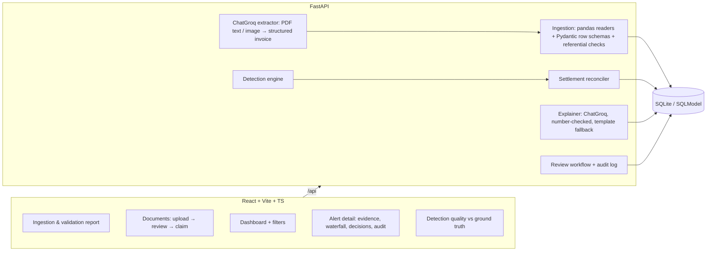

# Claims Sentinel — Claims Leakage Detection Agent (Level 1)

Validates health-insurance claims against policy terms, claim history and peer billing. It detects
financial leakage, works out the overpayment, explains each finding, and lets reviewers confirm, correct
or dismiss it.

**Design principle: the deterministic engine decides and the LLM explains.** Every finding and every
rupee comes from code with a traceable rule and calculation. The LLM only reads documents and writes
plain-language explanations, and an explanation is rejected if it adds any figure that isn't in the
evidence. The LLM is reached through LangChain's `ChatGroq`.

## Run it

Prerequisites: Python 3.12 + [uv](https://docs.astral.sh/uv/), Node 20+.

```bash
cd backend && uv sync && uv run python -m app.synthetic.generate      # writes ../sample_data
uv run uvicorn app.main:app --port 8000
```

```bash
cd frontend && npm install && npm run dev                              # http://localhost:5173
```

Open the dashboard and click **Load demo data**. To turn on LLM document extraction and explanations,
copy `backend/.env.example` to `backend/.env` and set `GROQ_API_KEY`. The models are `openai/gpt-oss-120b`
(text, JSON-schema output) and `qwen/qwen3.8-27b` (images and scanned PDFs); override them with
`GROQ_MODEL` / `GROQ_VISION_MODEL`. Without a key, everything except
PDF extraction still works, and explanations come from templates.

Tests: `cd backend && uv run pytest` runs 14 tests, including an end-to-end ground-truth check.

## Architecture



### Detection pipeline (per pending claim)

| Step | Module | What it does |
|---|---|---|
| Completeness | `engine/rules.py` | Missing diagnosis, stay dates, invoice no., or proposed amount → **NEEDS_INFO** with a clarification request. The checks that depend on that data are marked NA instead of being guessed. |
| Admissibility | `engine/rules.py` | R01 coverage (status, period, member), R02 initial/disease waiting periods, R03 diagnosis exclusions |
| Duplicates | `engine/duplicates.py` | D1 exact claim (invoice or identical incident), D2 repeated line, D3 line already billed on another claim, D4 near-duplicate (weighted similarity: invoice ref, dates, amount, provider, diagnosis, line overlap) |
| Legitimate-repeat guard | `engine/duplicates.py` | Recurring services (physio, dialysis, chemo, daily room/labs) on separate dates are cleared and recorded as "considered and cleared" |
| Line rules | `engine/rules.py` | R03 non-payables, R04 room and R05 ICU daily limits, R06 sub-limits and frequency caps (using history), R10 qty × rate arithmetic |
| Settlement | `engine/settlement.py` | billed → deductions → deductible → co-pay → sum-insured cap. Then a **hypothesis search** finds the simplest handler error that reproduces the proposed amount exactly, so every rupee of overpayment is attributed to a cause and deductions the handler applied correctly aren't flagged. |
| Provider outliers | `engine/provider_outliers.py` | Robust z-score (median/MAD) of each provider's price for a service vs peers → **SUSPECTED**, estimated excess vs peer P75 |

Every finding carries `finding_type` (confirmed violation / suspected pattern / needs info),
`amount_basis` (calculated / estimated / not determinable), the billed excess, the impact on the payout,
the calculation text, the policy clause and the evidence records.

## Synthetic data (`backend/app/synthetic`)

The generator is seeded and reproducible. It builds 300 policies (Silver/Gold/Platinum), about 730
members, 42 providers, about 1,400 paid history claims and about 1,080 pending claims from clinical
episode templates. Clean claims are settled correctly (non-payables and sub-limit excess deducted). It
then plants 17 scenarios and records each one in `ground_truth.csv`: exact and near duplicates,
duplicate lines within and across claims, room and ICU limits, non-payables, excluded diagnosis, lapsed
cover, waiting periods, sub-limits and frequency caps, deductible and co-pay errors, sum-insured
breaches, arithmetic errors, overpriced providers, incomplete evidence, combined claims, and about 300
**legitimate lookalikes** that must not be flagged. Claim `CLM-DEMO-01` reproduces the example from the
problem statement.

It also writes `claims_dirty.csv` (25 rows covering bad dates, negative amounts, unknown references,
duplicate IDs and so on), a multi-sheet `claims_bundle.xlsx`, JSON copies of each dataset, and sample PDF
invoices for the document flow.

**Current result on the sample data:** recall 100% and precision 100% at claim level, 0 false flags on
299 lookalikes, and calculated leakage matching ground truth to ±₹1 on every scenario.
