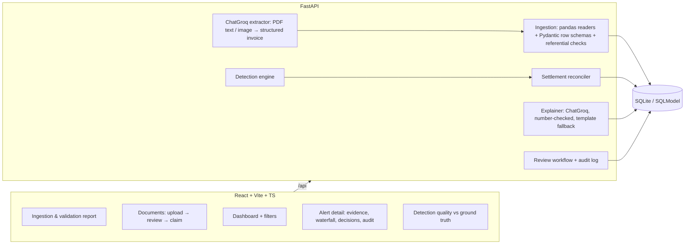

# Claims Sentinel — Claims Leakage Detection Agent (Level 1)

Validates health-insurance claims against policy terms, claim history and peer billing. It detects
financial leakage, works out the overpayment, explains each finding, and lets reviewers confirm, correct
or dismiss it.

**Design principle: the deterministic engine decides and the LLM explains.** Every finding and every
rupee comes from code with a traceable rule and calculation. The LLM only reads documents and writes
plain-language explanations, and an explanation is rejected if it adds any figure that isn't in the
evidence. The LLM is reached through LangChain's `ChatGroq`.

## Run it

Prerequisites: Python 3.12 + [uv](https://docs.astral.sh/uv/), Node 20+.

```bash
cd backend && uv sync && uv run python -m app.synthetic.generate      # writes ../sample_data
uv run uvicorn app.main:app --port 8000
```

```bash
cd frontend && npm install && npm run dev                              # http://localhost:5173
```

Open the dashboard and click **Load demo data**. To turn on LLM document extraction and explanations,
copy `backend/.env.example` to `backend/.env` and set `GROQ_API_KEY`. The models are `openai/gpt-oss-120b`
(text, JSON-schema output) and `qwen/qwen3.8-27b` (images and scanned PDFs); override them with
`GROQ_MODEL` / `GROQ_VISION_MODEL`. Without a key, everything except
PDF extraction still works, and explanations come from templates.

Tests: `cd backend && uv run pytest` runs 14 tests, including an end-to-end ground-truth check.

## Architecture



### Detection pipeline (per pending claim)

| Step | Module | What it does |
|---|---|---|
| Completeness | `engine/rules.py` | Missing diagnosis, stay dates, invoice no., or proposed amount → **NEEDS_INFO** with a clarification request. The checks that depend on that data are marked NA instead of being guessed. |
| Admissibility | `engine/rules.py` | R01 coverage (status, period, member), R02 initial/disease waiting periods, R03 diagnosis exclusions |
| Duplicates | `engine/duplicates.py` | D1 exact claim (invoice or identical incident), D2 repeated line, D3 line already billed on another claim, D4 near-duplicate (weighted similarity: invoice ref, dates, amount, provider, diagnosis, line overlap) |
| Legitimate-repeat guard | `engine/duplicates.py` | Recurring services (physio, dialysis, chemo, daily room/labs) on separate dates are cleared and recorded as "considered and cleared" |
| Line rules | `engine/rules.py` | R03 non-payables, R04 room and R05 ICU daily limits, R06 sub-limits and frequency caps (using history), R10 qty × rate arithmetic |
| Settlement | `engine/settlement.py` | billed → deductions → deductible → co-pay → sum-insured cap. Then a **hypothesis search** finds the simplest handler error that reproduces the proposed amount exactly, so every rupee of overpayment is attributed to a cause and deductions the handler applied correctly aren't flagged. |
| Provider outliers | `engine/provider_outliers.py` | Robust z-score (median/MAD) of each provider's price for a service vs peers → **SUSPECTED**, estimated excess vs peer P75 |

Every finding carries `finding_type` (confirmed violation / suspected pattern / needs info),
`amount_basis` (calculated / estimated / not determinable), the billed excess, the impact on the payout,
the calculation text, the policy clause and the evidence records.

## Synthetic data (`backend/app/synthetic`)

The generator is seeded and reproducible. It builds 300 policies (Silver/Gold/Platinum), about 730
members, 42 providers, about 1,400 paid history claims and about 1,080 pending claims from clinical
episode templates. Clean claims are settled correctly (non-payables and sub-limit excess deducted). It
then plants 17 scenarios and records each one in `ground_truth.csv`: exact and near duplicates,
duplicate lines within and across claims, room and ICU limits, non-payables, excluded diagnosis, lapsed
cover, waiting periods, sub-limits and frequency caps, deductible and co-pay errors, sum-insured
breaches, arithmetic errors, overpriced providers, incomplete evidence, combined claims, and about 300
**legitimate lookalikes** that must not be flagged. Claim `CLM-DEMO-01` reproduces the example from the
problem statement.

It also writes `claims_dirty.csv` (25 rows covering bad dates, negative amounts, unknown references,
duplicate IDs and so on), a multi-sheet `claims_bundle.xlsx`, JSON copies of each dataset, and sample PDF
invoices for the document flow.

**Current result on the sample data:** recall 100% and precision 100% at claim level, 0 false flags on
299 lookalikes, and calculated leakage matching ground truth to ±₹1 on every scenario.

---

# Level 2 — investigation workspace, roles and policyholder portal

## Sign in
Every API route is guarded by FastAPI's OAuth2 password flow with JWT (`pyjwt`, `pwdlib`). The login page lists
the demo accounts; the password for all of them is `demo1234`. Policyholder accounts appear after an admin runs
**Load demo data**.

| Role | Account | Responsibilities | Approval authority |
|---|---|---|---|
| Policyholder | e.g. `tanay033` (holder of CLM-DEMO-01) | File claims, upload evidence, answer requests, read decisions, ask for reconsideration | — |
| Claims Handler | `handler` | Triage new submissions; fast-track clean claims | ≤ ₹50,000, no findings |
| Claims Analyst | `analyst`, `analyst2` | Investigate assigned claims; decide every finding; propose the claim decision | ≤ ₹2,00,000 |
| Senior Claims Reviewer | `senior` | Resolve escalations; approve overrides and over-authority decisions | unlimited |
| SIU Investigator | `siu` | Resolve SIU referrals (substantiated / not); hold payment; SIU-only notes | — |
| Claims Ops Admin | `admin` | Users, data ingestion, analysis runs, audit verification, quality metrics | decides nothing |

How these rules are enforced:
- **Permissions:** named permissions per role live in `backend/app/auth/permissions.py`, and each route uses
  `require(permission)`.
- **Maker-checker:** an override more than ₹10,000 away from the recommendation, or a claim decision above the
  user's authority, waits for a senior. Nobody approves their own override or decision, and nobody resolves an
  escalation they raised.
- **Lifecycle:** claims move through `backend/app/workflow/lifecycle.py`:
  - DRAFT → SUBMITTED → TRIAGE / INVESTIGATION
  - INVESTIGATION ↔ INFO_REQUESTED / ESCALATED_* → PENDING_APPROVAL → APPROVED / PARTIALLY_APPROVED / REJECTED
  - REJECTED → RECONSIDERATION

  Policyholders only see Submitted · Under review · Action needed · Decision made · Paid.

## Level 2 capabilities
| Requirement | Where |
|---|---|
| Cross-claim correlation | `engine/correlation.py`: links claims through the same provider invoice on different policies, shared payout accounts, shared document images, the same incident, shared phone/address, and identical high-value services. Strong links and clusters of 3+ policies become **Related claims** findings, each listing the matching attributes |
| Document & invoice analysis | `documents/evidence.py` + `engine/doc_compare.py`. Every extracted value keeps its page and source text and is *verified* only if that text is found on the page. Claim vs bill vs discharge summary yields lines missing from the bill, amounts above the bill, room days beyond the documented stay, and date or diagnosis differences |
| Investigation workspace | `/investigations/:claim`: findings and corrections, evidence viewer and comparison, related-claims map, policy terms and rules, notes (internal / SIU-only), timeline |
| Recommended corrections | `engine/recommendations.py`: typed corrections (remove line, cap daily rate, cap at sub-limit, apply co-pay, decline claim, …), each with original amount, corrected amount, calculation and clause. Stored as immutable versions |
| Analyst decisions | Confirm discrepancy · False positive (with a reason) · Request evidence · Escalate to Senior or SIU · Accept correction (optionally with a reasoned override; the original recommendation is kept) |
| Evidence & audit trail | `audit.py`: an append-only, SHA-256 hash-chained event log of analysis results, recommendations, decisions, overrides, requests, escalations, notes and policyholder actions, with actor and timestamp. `GET /api/audit/verify` detects any edit. Reports at `/api/investigations/{id}/report.pdf` and `.json` |
| Policyholder portal | `/portal`: claim wizard (the bill is read for the policyholder to confirm), status tracking, answering requests with uploads, decision letter with a plain-language breakdown and PDF, reconsideration |

## Ground truth
The synthetic data adds scenarios 18–25: the same invoice on two policies, a payout-account ring, relatives sharing
an address (must not be flagged), claim lines not on the bill, amounts above the bill, stays longer than the
discharge summary, admission-date differences, and 40 claims whose documents match (must not be flagged). Claim-level
precision and recall are 100% across all 25 scenarios.

## Tests
`cd backend && uv run pytest` runs 27 tests:
- the Level 1 engine
- forensics
- RBAC
- the investigation workflow: decisions, maker-checker, SIU, authority, tamper detection
- the portal journey, which checks that no internal fields appear in portal responses
